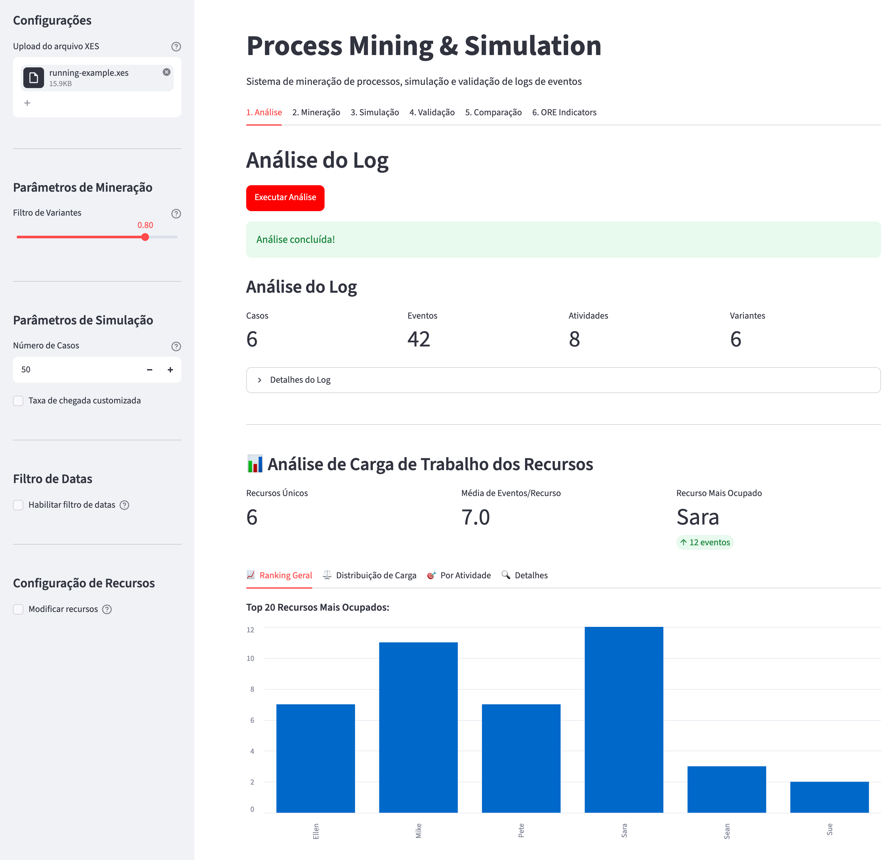
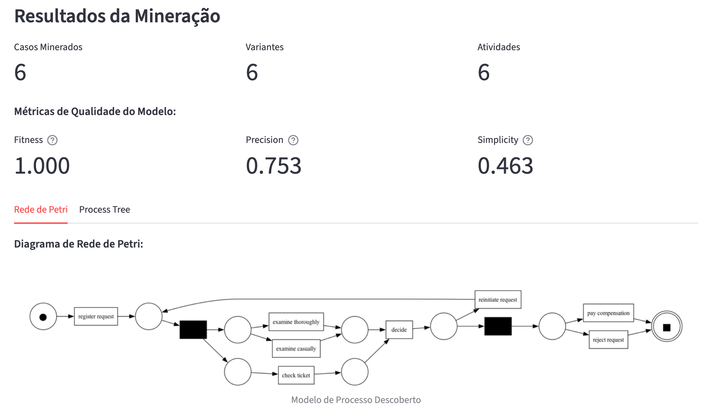
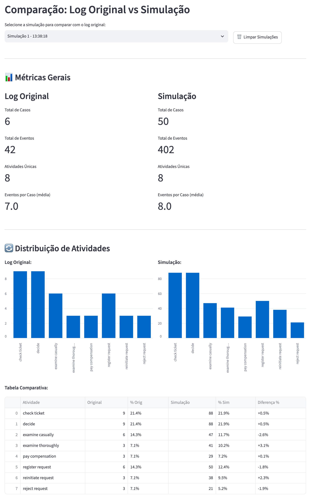

# Sim2Log

Sim2Log takes an event log in XES format, discovers the process behind it, simulates that process to produce a synthetic log, and checks how close the synthetic log is to the original. I built it as the code for my undergraduate thesis at PUCPR, "Simulation model generator for short-term decision-making using process mining" (2025). The thesis text is in [viniciusbregoli/TCC](https://github.com/viniciusbregoli/TCC) ([PDF](https://github.com/viniciusbregoli/TCC/blob/main/tcc.pdf)). The case study was a hospital's surgical scheduling, which is why the last step computes Operating Room Effectiveness (ORE) indicators.

## Screenshots

The screenshots use pm4py's public `running-example.xes` (6 cases, 42 events), not the hospital data from the thesis.

Log analysis after uploading a file:



Process model discovered with the Inductive Miner, with its quality metrics:



Original log compared with a 50-case simulation:



## What it does

The pipeline (`pipeline.py`) runs five steps. Each one can also be called on its own.

1. **Log analysis** (`log_analyzer.py`): loads the XES log, counts cases, events, activities and variants, and detects which attributes hold the activity, timestamp, case id and resource.
2. **Process discovery** (`process_mining.py`): keeps the most frequent variants (80% by default), discovers a Petri net and a process tree with pm4py's Inductive Miner, and scores the model on fitness, precision and simplicity. It also extracts per-activity durations, fits normal, lognormal and exponential distributions to them (best fit chosen by Kolmogorov-Smirnov p-value), and computes the case arrival rate and the resources seen for each activity.
3. **Simulation** (`simulation.py`): a SimPy discrete-event simulation that plays the token game on the discovered Petri net. Cases arrive at the mined arrival rate, each enabled transition is picked at random, each activity takes its mean mined duration, and a resource is drawn from the ones observed for that activity. The output is a synthetic log written as CSV and XES.
4. **Validation** (`validation.py`): compares the original and the synthetic log with pm4py's edit-distance log alignments and reports average fitness, alignment cost and a similarity percentage. The app's comparison tab also puts activity and resource distributions of both logs side by side.
5. **ORE indicators** (`ore_indicators.py`): computes availability, performance, quality and ORE (their product) following Souza, Vaccaro and Lima (2020), along with the time lost to setup, cancellations, duration variation and other causes. This step expects an XES log enriched with surgery attributes (`surgery:status`, `surgery:duration_real_minutes`, `surgery:cancellation_reason`), as produced by the scripts in `converters/`.

The Streamlit app in `app/` exposes the same steps as tabs (analysis, mining, simulation, validation, comparison, ORE), with sidebar controls for the variant filter, number of simulated cases, arrival rate, date range and per-activity resources.

## Stack

- Python 3.11+
- [pm4py](https://pm4py.fit.fraunhofer.de/) for XES import/export, Inductive Miner, model quality metrics and log alignments
- [SimPy](https://simpy.readthedocs.io/) for the discrete-event simulation
- pandas and SciPy for statistics and distribution fitting
- Streamlit for the web app
- Graphviz (system package) to render the Petri net and process tree images
- Sphinx for the API docs

## Run it

You need Python 3.11.12 or newer and Graphviz (`brew install graphviz` or `apt install graphviz`). With [uv](https://docs.astral.sh/uv/):

```bash
uv sync
uv run streamlit run app/app.py
```

The app opens at `http://localhost:8501`. Upload an XES log in the sidebar and run the tabs in order. Uploaded files go to `app/uploads/` and results to `app/outputs/`, both ignored by git. Without uv, install the dependencies listed in `pyproject.toml` with pip (`app/requirements.txt` only lists the extra app packages).

To run the pipeline from Python instead:

```python
from pipeline import ProcessMiningPipeline

pipeline = ProcessMiningPipeline()
results = pipeline.run_full_pipeline("log.xes", num_simulated_cases=100)
print(results["validation_result"].similarity_percentage)
```

`test.py` runs mining, simulation and validation from the command line: `python test.py log.xes --num-cases 100`.

## Layout

| Path | Contents |
| --- | --- |
| `pipeline.py` | `ProcessMiningPipeline`, the entry point that chains the five steps |
| `log_analyzer.py` | Log profiling and attribute detection |
| `process_mining.py` | Variant filtering, Inductive Miner discovery, quality metrics, duration fitting |
| `simulation.py` | SimPy simulator that writes the synthetic CSV and XES logs |
| `validation.py` | Edit-distance comparison of original and synthetic logs |
| `ore_indicators.py` | ORE indicators and loss breakdown |
| `models.py` | Dataclasses shared between the steps |
| `utils.py` | Formatting and comparison helpers |
| `converters/` | Scripts that turn the hospital spreadsheet export into an enriched XES log |
| `app/` | Streamlit web app |
| `docs/` | Sphinx documentation source |
| `test.py`, `test_mining_metrics.py` | Command-line scripts to run the workflow and debug the quality metrics |

## Docs

The API reference is generated with Sphinx from the docstrings:

```bash
uv run --with sphinx --with sphinx-rtd-theme ./docs/build_docs.sh
```

Then open `docs/build/html/index.html`. See [docs/README.md](docs/README.md) for the docs structure.
